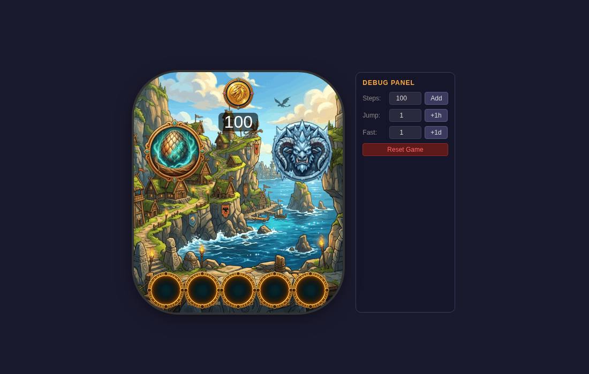

# Dragon Army

A Zepp OS / Amazfit pet-battler inspired by *How to Train Your Dragon*.
Hatch dragon eggs, train them, fight spawn-based monsters, and take down the
**Bewilder Beast** boss with your roster.



## Quick start

```sh
npm install          # root deps: vitest, esbuild, prettier
npm test             # engine unit + balance + layout + view tests (vitest)
npm run dev          # web preview: watch UI + debug panel (+hours/+days, reset)
npm run build        # web preview production build (web/dist)
npm run build:engine # regenerate engine/*.js from engine/*.ts (see below)
make check           # tests + regenerate engine JS (fails if committed .js is stale)
```

**Watch build.** This repo *is* the Zepp OS app source (`app.json`,
`app.js`, `page/`, `assets/`). Open it in Zeus Studio (or the `zeus` CLI)
to build and install it on a watch. Run `npm run build:engine` first so the
generated `engine/*.js` files are fresh — zeus bundles `.js` only, never
`.ts`.

## How to play

1. **Buy Egg** (top-left on the main hub) — spin-then-pay: tap Reveal to freeze
   the spin, then OK to pay 100 coins (or `>` to pick a specific breed for
   150). The egg hatches in 24–48h real time.
2. **Navigate by tapping** — the main hub has a bottom roster-strip of
   thumbnails; dragon detail screens return via **Home**.
   (There is no swipe navigation — it proved unreliable on the real device.)
3. **Train** a hatched dragon — costs coins (scales with strength) **and 15
   energy** per session, raises strength by +2–5 (clamped at 125 max).
   Strength renders as stars: 5 strength = 1 silver star, 5 silver = 1 gold.
4. **Fight monsters** — only spawned monsters (0–3) are listed. Fights play
   on a dedicated fight screen (dragons left, monster right, green HP bars,
   fireballs, hit/miss). Winning gives coins **plus permanent strength**
   (Easy +1–2, Medium +1–2, Hard +2–4); losing knocks the dragon out
   (energy 0), strength unchanged.
5. **Fight the Bewilder Beast** (top-right) — all hatched dragons with energy
   > 0 attack in roster order each round; the beast fires back at **one
   random dragon** per round. Dragons dropped to 0 are removed. Winning
   vanishes the beast for a day and grants every dragon that attacked
   **+2–4 permanent strength** plus 300 coins. Losing heals the beast back
   to full HP — no grinding it down across attempts.
6. **Equip a dragon** — tap the equipment icon (top-left on a hatched
   dragon's page) for its 7 slots: Dragon Helm (+5, 100c), Wing Guards
   (+5, 100c), Tail Guard (+4, 80c), and one Leg Guard per leg (+3, 60c
   each). Full set: **+26 combat strength for 520 coins**. Equipment adds
   to combat strength only (base strength, training costs, and the 125 cap
   are unchanged); selling a geared dragon refunds 50% of its gear cost.
   Monsters wear gear too — Easy none, Medium head + leg (+8), Hard all but
   one leg (+23) — and the Beast wears the full set (display 101 = 4 gold
   stars, combat defense 46). A bare base-40 dragon barely scratches it;
   three fully equipped base-40 dragons (combat 66) win ~62% of fights —
   strong but no longer a guarantee; two at 66 almost never win.
7. **Earn Coins** — hourly coins accrue but are credited only by tapping the
   coin icon when it appears. Energy recovers passively (10/hour).

## Architecture

```
                 ┌────────────────────────────────────┐
  platform       │ utils/ adapters (watch)            │  web/src/adapters/ (preview)
  boundary       │ storage · time · steps · device    │  localStorage · debug clock
                 └──────────────┬─────────────────────┘
                                │ injected deps
                 ┌──────────────▼─────────────────────┐
  rules          │ engine/ — pure + stateful, no I/O   │
  (testable)     │ config.ts · engine.ts · utils.ts   │
                 │ types.ts (all shared shapes)       │
                 └──────────────┬─────────────────────┘
                                │ views / results
                 ┌──────────────▼─────────────────────┐
  presentation   │ page/ — Zepp OS UI, no game rules  │
  (watch)        │ index.js · layouts.js · index.style │
                 │ viewUtils.js (pure view math)     │
                 └────────────────────────────────────┘
```

**Rules:**

- **The engine never touches I/O.** `createGameEngine({ storage, getTime,
  getSteps, rand01, generateId })` receives every platform boundary as an
  injected dependency. The page wires the real adapters; tests inject fakes.
- **Balance lives in exactly one place: `engine/config.ts`.** All formulas
  are pure functions there (`sellPrice()`, `resolveMonsterFight()`,
  `resolveBeastFight()`, …). The page and the engine never reimplement a
  formula or hardcode a balance number.
- **Computed, not stored.** A `Dragon` persists only event anchors (ids,
  strength, energy-at-timestamp, hatch anchors, equipment, battle record).
  Stage, age, live energy, level, sell price, and lifespan countdown are
  derived on every read via pure functions, so saves can't drift after
  offline gaps and the tick loop stays idempotent.
- **The page holds no rules.** `page/index.js` renders widgets, tracks
  transient animation state (egg spin, fight-screen replay), and calls the
  engine. Colors/fonts/assets live in `page/index.style.js`; every pixel
  coordinate lives in `page/layouts.js` (see Devices below).
- **TypeScript is the source of truth for the engine; `.js` is generated.**
  `engine/*.ts` is what vitest runs. `npm run build:engine` transpiles it
  to `engine/*.js` with esbuild because zeus bundles `.js` only. The
  generated files are committed (the watch build needs them) — never edit
  them by hand; `make check` fails if they go stale.

### Modules

| Path | What it is |
|---|---|
| `engine/config.ts` | Balance catalogue + every pure game formula (economy, eggs, energy, training, selling, equipment, battles, beast). |
| `engine/engine.ts` | Stateful session: boot/migration, tick, egg/train/sell/fights, coins, UI slice. Only module allowed to mutate state. |
| `engine/utils.ts` | Pure factories / anchor math / log text (egg creation, energy anchors, tap-to-collect anchors). |
| `engine/types.ts` | Every shared type: `Dragon`, `Player`, `GameState`, result unions. All persisted fields are plain JSON. |
| `page/index.js` | Watch screens + modals, navigation, widget helpers, transient animation state. |
| `page/layouts.js` | Per-device geometry tables (`bip6`, `round480`) + `refreshLayout()` live bindings. |
| `page/index.style.js` | Theme: palette, typography, asset paths, energy-bar slot map. No coordinates. |
| `page/viewUtils.js` | Pure view math extracted from the page (name formatting, energy-bar segments, roster windowing, action-row positions, fight-screen geometry). Fully unit-tested. |
| `utils/` | Watch platform adapters: `storageAdapter` (local file), `timeAdapter` (`Date.now`), `sensorAdapter` (step counter), `deviceAdapter` (`@zos/device`). |
| `web/` | Desktop preview: React shell + `zepp-web-runner` + `WatchPageFixed` (1:1 IMG renderer matching the watch) + `DebugPanel` (device switch, +hours/+days, steps, reset). Vite `adapterMappings` swap the `utils/` adapters for web ones. |
| `scripts/build-engine.mjs` | TS → JS codegen for the engine (esbuild). |
| `optimize/` | PNG tools: `optimize.mjs` (sharp palette + max compression) and `resize.mjs` (scale to exact widget sizes per `assets.json`). |
| `sprites/` | Vendored `spritecut` CLI: cuts sprite sheets (`raw/*.png`) into individual icons. |
| `Makefile` | The asset data pipeline (below). |
| `docs/core.md` | Game rules (canonical design reference). |
| `docs/interface.md` | Screens, modals, workflows. |

### State flow

```
boot:  storage.load() → coerceLoadedSave() / migrateLegacySave()
       → engine.init() → tick(now) → save()
tick (every 5s + every render): expiry → beast respawn → spawn refresh
       (recovery / coins / age are derived, never tick-written;
        hatching is a manual tap, never automatic)
action: page → engine method → pure formula (config.ts) → state update
       → storage.save(JSON) → page re-renders from engine views
```

Saves are one JSON object (`GameState`: player + beast + spawn + UI slice).
Old saves are upgraded on load: pre-engine `{ coins, dragons }` shapes are
migrated, and missing fields (`combatStats`, `equipment`,
`lastCollectedSteps`) are backfilled — old progress is never dropped.

## Data pipeline (art)

Zepp OS draws `IMG` widgets 1:1 — no runtime scaling. Every PNG is
therefore pre-cut and pre-scaled to its exact widget size before it ships:

```
raw/  ──►  assets/  ──►  assets/default.{b,r,s}/
  │          │                    │
  │          │  scale (resize.mjs + assets.json)
  │          │  optimize (optimize.mjs, sharp)
  │          └─ per-device copies (Makefile `zepp`)
  │
  └─ sources: sprite sheets, backgrounds, icon, equipment art
```

```sh
make data      # full pipeline: icon + bg + misc + sprites + scale + optimize + zepp
make sprites   # cut raw/*.png sheets into assets/{ui,eggs,dragons,monsters}/
make scale     # scale PNGs to exact widget sizes per assets.json (deletes originals)
make optimize  # compress assets/ in place
make zepp      # mirror assets/ into assets/default.{b,r,s} (one per device class)
make clean     # remove generated assets
```

- `assets.json` is the manifest: each source PNG maps to the list of
  `WxH` sizes it is displayed at (e.g. dragons → `60x60` + `240x240`).
  Entries with an empty list (unused art) are deleted by `scale`.
- `raw/icon_source.png` is the un-cropped icon source; `raw/equipment/`
  holds the equipment art, `raw/fight/` the fireball + impact FX.
  `store/` holds the app-store listing assets.
- `assets/` (including `default.{b,r,s}`) is generated but committed — the
  watch build reads it directly. `web/public/images` is a symlink to
  `assets/` so the preview serves the same files.

## Balance at a glance

| Action | Cost | Reward |
|---|---|---|
| Egg | 100 coins | random of 16 breeds |
| Chosen egg | 150 coins | specific breed |
| Train | coins (8 + 0.8×str) + 15 energy | +2–5 strength (max 125) |
| Monster win | ~⅓ of the HP bar (damage taken) | coins + strength (+1–2 / +1–2 / +2–4) |
| Monster loss | energy → 0 | strength unchanged |
| Beast win | HP lost to ~56-damage beast hits | 300 coins + 2–4 strength per attacker |
| Beast loss | whole team removed | beast heals to full HP |
| Equipment (full set) | 520 coins | +26 combat strength (helm 100, wings 100, tail 80, legs 60×4) |

## Testing

```sh
npm test          # vitest: engine + layouts + view utils
npm run test:watch
```

| Suite | What it pins |
|---|---|
| `engine/config.test.ts` | Every pure formula: economy, hatch, energy, stars, training, selling, equipment, battle math. |
| `engine/engine.test.ts` | Session flow: boot/migration, egg/train/sell, coins, monster + beast fights, tick idempotency. |
| `engine/balance.test.ts`, `engine/finetune.test.ts` | Playability targets: fresh dragons vs Easy, gear vs Medium/Hard/Beast, economy pacing. |
| `page/layouts.test.mjs` | Layout tables share keys, art-bound sizes never shrink, round-480 geometry stays inside the circle, `refreshLayout` covers every key. |
| `page/viewUtils.test.mjs` | Pure view math: name formatting, energy segments, roster window, action-row positions, fight-screen geometry. |

`npm run format` formats the sources with prettier (`.prettierrc`:
single quotes, width 100). Generated `engine/*.js` is excluded.

## Supported devices

- **Amazfit Bip 6** (rect 390x450) — primary, tested on-device.
- **Round 480x480 watches** (Active / Balance / T-Rex round series;
  466/454/416 rounds reuse the same layout) — the app detects the device via
  `@zos/device` at startup and loads the matching coordinate table from
  `page/layouts.js`. No UI forks: screens use the loaded coordinates as
  constants. Preview either device in the web runner via the debug panel's
  Device selector (`npm run dev`).

## What could look better (from a playtest pass)

Playtested via engine simulation (buy → hatch → train → monster/beast fights)
plus a real render of the web preview (screenshot above). Biggest visual wins:

1. **Icon labels** — Buy Egg / Beast / Train / Sell / Danger are icon-only;
   first-time players can't tell what they do. Add 1-line labels under each.
2. **Monster names** — opponents are literally called "monster 1/2/3". Give
   them breed-style names and matching portraits (currently reuses dragon art).
3. **Egg-spin symbols** — the spin cycles placeholder glyphs (`167468123?!-+`);
   spin through mini egg/dragon icons instead.
4. **Empty roster slots** — five dark holes on a fresh game read as missing
   art; show a faint egg silhouette or "+" instead.
6. **Numbers on bars** — energy/beast HP bars have no numeric readout; add
   small `72/100`-style text for clarity on a tiny screen.
7. **Fight pacing** — done: fights moved from the locked text modal to a
   full-screen fight screen with fireballs, hit/miss, HP bars, ~1.1s/turn,
   and tap-to-skip. Remaining: victory flash + haptics.
8. **Text contrast** — white text over the bright home/ocean background is
   saved only by the dark pill; extend the pill treatment to every floating
   label (coin delta, level line).
9. **Debug panel in builds** — the side debug panel is dev-only; strip it from
   production screenshots/builds.
10. **Beast intro hierarchy** — HP bar + "N dragon(s) ready" + warning compete;
    stack as title → HP → team → warning → Fight with more breathing room.

## Conventions

- The engine's public surface is pure where possible; stateful methods
  return result unions (`{ ok: true, … } | { ok: false, reason }`) — the page
  never throws on a refused action.
- Never store a derived value. If it can be computed from anchors + `nowMs`,
  compute it.
- Never read a balance number outside `engine/config.ts`.
- `page/` never imports `@zos/*` except through `utils/` adapters.

## Cleanup notes (2026-10-15)

This tree went through a cleanup pass: dead code removed
(`shared/engineRegistry.js`, `utils/constants.js`, 40+ unused theme
constants, the stale `docs/idea.md` duplicate, the unused `appendFightLog`
helper), duplicated logic unified (egg purchase in the engine, action-row
and egg-finish helpers in the page, one import path for layout constants),
and page view math extracted into tested `page/viewUtils.js`.
`docs/core.md` / `docs/interface.md` were corrected to match the engine
(16 breeds, monster gains +1–2/+1–2/+2–4, beast survivor gains +2–4,
monster loss knocks energy to 0).
